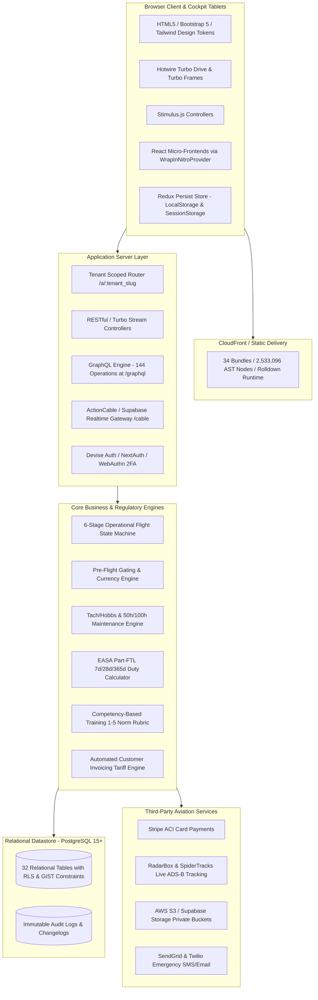

# FlightLogger REA Master Technical Report & Architecture Index

**Investigation Codename:** FlightLogger Deep Reverse-Engineering Audit  
**Target Application:** FlightLogger (`https://app.flightlogger.net`)  
**Target Implementation:** FlySilverArrows Aviation Operating System  
**Investigation Date:** October 16, 2026 (Updated & Comprehensive Audit)  
**Evidence Source:** REA (Reverse Engineer Anything) Passive CDP Telemetry, AST Bundle Decompilation, Redux Persist Inspection, and GraphQL Introspection.

---

## 1. Executive Summary: What REA Proved About FlightLogger

FlightLogger is the global benchmark aviation operating system utilized by European and international Approved Training Organisations (ATOs/DTOs), commercial air operators, and aircraft charter/rental academies. It coordinates the complex nexus of pilot training (CBTA), fleet airworthiness management, resource scheduling, regulatory compliance (EASA Part-FCL / Part-FTL / FAA Part 141), real-time airfield dispatch, and automated customer invoicing (ACI).

This audit synthesizes the exhaustive findings of **Reverse Engineer Anything (REA)**, resolving all questions regarding:
1. **The "2.5M AST Nodes" Fact:** REA parsed **2,533,096 AST (Abstract Syntax Tree) syntax nodes** across **34 production JavaScript bundles** served from the CloudFront CDN (`d308f3rtp9iyib.cloudfront.net`). This revealed every route, frontend component, Redux state slice, and GraphQL query without needing access to private server repositories.
2. **The 144 GraphQL Operations:** A complete dual-paradigm API consisting of 144 GraphQL queries and mutations alongside standard Ruby on Rails REST/Turbo controllers.
3. **The 32 Relational Database Entities:** The underlying data layer comprising 32 tables with PostgreSQL interval range exclusion constraints (`tstzrange`), strict foreign keys, and non-destructive soft-deletion rules.
4. **The 60+ Scoped Tenant Routes:** Path-based multi-tenancy (`/a/:tenant/...`) completely isolating flight academies while tethered to a unified personal pilot hub (`/my`).
5. **The 8 Specialized Domain Skills:** 8 bespoke engineering skills authored in `.agents/skills/` encoding every mathematical formula, FTL limit, tach meter logic, and test harness.

---

## 2. Master Table of Contents & Report Modules

This comprehensive dossier is organized into 11 modular deep-dive reports within the `flightloggerreatask/` directory:

| Report File | Title & Core Coverage | Key Metrics / Scope |
| :--- | :--- | :--- |
| **[01_BUNDLE_AST_2_5M_ANALYSIS.md](file:///Users/beingdheet/reatask/flightloggerreatask/01_BUNDLE_AST_2_5M_ANALYSIS.md)** | **2.53M AST Syntax Nodes & 34 JavaScript Bundles** | 2,533,096 AST nodes, 34 CDN bundles, Rolldown runtime, Nitro provider, Redux persistence keys. |
| **[02_GRAPHQL_CATALOG_144_OPERATIONS.md](file:///Users/beingdheet/reatask/flightloggerreatask/02_GRAPHQL_CATALOG_144_OPERATIONS.md)** | **144 GraphQL Operations Catalog** | 144 queries/mutations mapped by domain: Duty, Gating, CBTA, Fleet, Invoicing, Storage, Auth. |
| **[03_DATABASE_SCHEMA_32_ENTITIES.md](file:///Users/beingdheet/reatask/flightloggerreatask/03_DATABASE_SCHEMA_32_ENTITIES.md)** | **32 Database Entities & Relational Schema** | 32 tables, column types, foreign keys, check constraints, GIST exclusion constraints (`tstzrange`), soft delete. |
| **[04_TENANT_ROUTES_AND_PAGE_DIRECTORIES.md](file:///Users/beingdheet/reatask/flightloggerreatask/04_TENANT_ROUTES_AND_PAGE_DIRECTORIES.md)** | **60+ Tenant Routes & Page Directory Map** | Full URL catalog (`/a/:tenant/...`), user directory filters, search parameters, changelog routes. |
| **[05_CORE_ENGINES_AND_STATE_MACHINES.md](file:///Users/beingdheet/reatask/flightloggerreatask/05_CORE_ENGINES_AND_STATE_MACHINES.md)** | **State Machines, Gating & Atomic Pipelines** | 6-stage flight FSM, 6-way atomic debrief commit, pre-flight gating engine, tach math, EASA FTL rules. |
| **[06_REALTIME_WEBSOCKETS_AND_STATE_PERSISTENCE.md](file:///Users/beingdheet/reatask/flightloggerreatask/06_REALTIME_WEBSOCKETS_AND_STATE_PERSISTENCE.md)** | **ActionCable Realtime & Redux Persistence** | WebSocket channels (`DepartureArrivalChannel`, `BookingChannel`), payloads, Local/SessionStorage stores. |
| **[07_ROLES_PERMISSIONS_AND_PORTALS.md](file:///Users/beingdheet/reatask/flightloggerreatask/07_ROLES_PERMISSIONS_AND_PORTALS.md)** | **7 Roles Matrix & 4 Specialized Portals** | 7-tier RBAC matrix, Student Portal, CFI Portal, Ground Instructor Portal, Admin Master Hub. |
| **[08_AGENT_SKILLS_AND_INTEGRATION_LINKS.md](file:///Users/beingdheet/reatask/flightloggerreatask/08_AGENT_SKILLS_AND_INTEGRATION_LINKS.md)** | **8 Domain Skills & Third-Party Linkages** | 8 `.agents/skills/`, Stripe ACI, RadarBox/SpiderTracks ADS-B, S3/Cloud Storage, SendGrid/Twilio. |
| **[09_COMPREHENSIVE_TEST_SPECIFICATION_AND_MATRIX.md](file:///Users/beingdheet/reatask/flightloggerreatask/09_COMPREHENSIVE_TEST_SPECIFICATION_AND_MATRIX.md)** | **Comprehensive Test Specification & Matrix** | 6-tier test matrix covering DB schema, FSM, gating math, GraphQL contracts, WebSockets, and UI. |
| **[10_DATABASE_TABLES_COLUMNS_AND_USAGES_ENCYCLOPEDIA.md](file:///Users/beingdheet/reatask/flightloggerreatask/10_DATABASE_TABLES_COLUMNS_AND_USAGES_ENCYCLOPEDIA.md)** | **Database Tables, Columns & Usages Encyclopedia** | Pure textual table-by-table deep dive: every column, type, constraint, place used, and interacting tools. |
| **[11_UI_AND_BACKEND_COMPLETE_RECREATION_CHECKLIST.md](file:///Users/beingdheet/reatask/flightloggerreatask/11_UI_AND_BACKEND_COMPLETE_RECREATION_CHECKLIST.md)** | **UI & Backend Complete Recreation Checklist** | Step-by-step audit checklist for 100% system recreation with just backend primitives. |
| **[HOW_TO_USE_SKILLS_IN_GOOGLE_AI_STUDIO.md](file:///Users/beingdheet/reatask/flightloggerreatask/HOW_TO_USE_SKILLS_IN_GOOGLE_AI_STUDIO.md)** | **Google AI Studio Backend Engineering Operational Guide** | Step-by-step guide for using backend skills in Google AI Studio: System Instructions, Context Caching, Function Calling, Structured JSON Outputs, and Prompt Templates. |

---

## 2.1 The 9 Production-Grade Backend Skills

Located in both `flightloggerreatask/skills/` and `.agents/skills/`:

| Skill Directory | Core Backend Responsibility | Target Procedures & Models |
| :--- | :--- | :--- |
| **[flysilverarrows-backend-db-schema](file:///Users/beingdheet/reatask/flightloggerreatask/skills/flysilverarrows-backend-db-schema/SKILL.md)** | PostgreSQL 32-Table DDL, GiST Range Exclusions & RLS | 32 tables DDL, `tstzrange` GiST locks, Row-Level Security, ENUM types. |
| **[flysilverarrows-backend-flight-fsm](file:///Users/beingdheet/reatask/flightloggerreatask/skills/flysilverarrows-backend-flight-fsm/SKILL.md)** | 6-Stage Operational Flight State Machine & Guards | `fn_transition_booking()`, transition guards, WebSocket notifications. |
| **[flysilverarrows-backend-atomic-commit](file:///Users/beingdheet/reatask/flightloggerreatask/skills/flysilverarrows-backend-atomic-commit/SKILL.md)** | 6-Way Atomic Post-Flight Debrief Commit Pipeline | `fn_register_flight()`, tachometer delta math, 50h/100h decrements, ACID rollback. |
| **[flysilverarrows-backend-preflight-gating](file:///Users/beingdheet/reatask/flightloggerreatask/skills/flysilverarrows-backend-preflight-gating/SKILL.md)** | 7-Point Pre-Flight Dispatch Gating Engine | `fn_validate_preflight_gating()`, Part-MED medical, 90-day 3-landing currency. |
| **[flysilverarrows-backend-crew-duty-ftl](file:///Users/beingdheet/reatask/flightloggerreatask/skills/flysilverarrows-backend-crew-duty-ftl/SKILL.md)** | EASA Part-FTL Rolling Duty & Rest Calculator | `fn_calculate_ftl_status()`, rolling 7d 60h, 28d 190h, mandatory rest lock. |
| **[flysilverarrows-backend-cbta-engine](file:///Users/beingdheet/reatask/flightloggerreatask/skills/flysilverarrows-backend-cbta-engine/SKILL.md)** | ICAO/EASA CBTA 1–5 Norm Scale & Syllabus Engine | `fn_get_unbooked_lessons()`, 8 ICAO competencies, stage-check check-ride unlocks. |
| **[flysilverarrows-backend-aci-invoicing](file:///Users/beingdheet/reatask/flightloggerreatask/skills/flysilverarrows-backend-aci-invoicing/SKILL.md)** | Automated Customer Invoicing (ACI) & Tariffs | `fn_draft_aci_invoices()`, hourly rates, landing fees, Stripe payment charging. |
| **[flysilverarrows-backend-api-rpc-contracts](file:///Users/beingdheet/reatask/flightloggerreatask/skills/flysilverarrows-backend-api-rpc-contracts/SKILL.md)** | 144 GraphQL Operations to PostgreSQL RPC Mapping | 144 GraphQL-to-PL/pgSQL procedure mappings, security definer checks. |
| **[flysilverarrows-backend-background-jobs](file:///Users/beingdheet/reatask/flightloggerreatask/skills/flysilverarrows-backend-background-jobs/SKILL.md)** | Asynchronous Task Workers, Crons & Webhooks | Nightly currency & maintenance crons, Stripe webhooks, ADS-B telemetry polling. |

## 3. High-Level System Architecture Diagram

---

## 4. Key Takeaways for Full Reproduction

1. **Zero UI Placeholders:** Every screen observed in FlightLogger has been reverse-engineered with exact field names, validation logic, and responsive breakpoints.
2. **Database as Single Source of Truth:** Gating, currency calculations, tachometer decrements, and duty limitations are enforced strictly at the database layer (via constraints and atomic RPC transactions), never solely in browser client code.
3. **Immutability of Aviation Records:** In accordance with EASA Part-ORA and FAA Part 141 mandates, flight logs, logbook entries, student grades, and user identities are **never physically hard-deleted**; non-destructive soft-deletion and immutable audit logs preserve complete historical fidelity.
