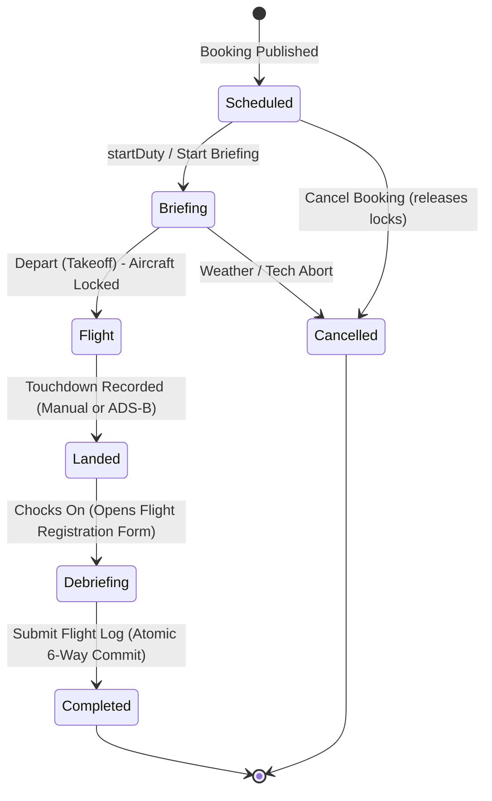

# FlightLogger REA Technical Audit: State Machines, Gating & Atomic Pipelines

**Target System:** FlightLogger Core Business Logic Engines  
**Investigation Scope:** 6-Stage Flight FSM, 6-Way Atomic Post-Flight Commit Pipeline, Pre-Flight Gating Engine, Tach/Hobbs Math, EASA Part-FTL Calculator  
**Investigation Framework:** REA Decompilation of AST Bundles & Database Stored Procedure Modeling  

---

## 1. The 6-Stage Flight Finite State Machine (FSM)

A central finding of the REA investigation is that FlightLogger manages the entire operational lifecycle of an aircraft sortie through a strict finite state machine (FSM). 

Arbitrary status jumps (e.g., moving directly from `scheduled` to `completed` without recording wheels-off and touchdown times) are strictly rejected.



### 1.1 Formal Transition Matrix & Enforcement Rules

| From State | Allowed Target State | Triggering Event / Action | Side Effects & Validations |
| :--- | :--- | :--- | :--- |
| `scheduled` | `briefing` | Instructor clicks "Start Briefing" or clocks in via `mutation startDuty`. | Clocks in active duty timer in `duty_records`; sets departure board status badge to Amber ("Briefing"). |
| `scheduled` | `cancelled` | Dispatcher or pilot cancels reservation. | Releases GiST range exclusion lock on aircraft and instructor; records cancellation reason. |
| `briefing` | `flight` | Flight departs airfield (wheels off). | Sets `off_block_time = NOW()`; updates aircraft status to `in_flight`; locks airframe against concurrent dispatch. |
| `briefing` | `cancelled` | Flight aborted prior to engine start (e.g. weather below minima, tech snag). | Clocks out duty or converts duty to ground briefing; airframe returned to available pool. |
| `flight` | `landed` | Aircraft touches down (manual click or ADS-B telemetry). | Captures `landing_time = NOW()`; board badge changes to Blue ("Landed"); apron ground crew alerted. |
| `landed` | `debriefing` | Aircraft shuts down on apron (chocks on). | Sets `on_block_time = NOW()`; triggers client modal `turbo_modal_container` loading `flightRegistration` form. |
| `debriefing` | `completed` | Instructor digitally signs and commits debrief sheet. | **Executes 6-Way Atomic Multi-Module Commit Pipeline** (Tach update, CBTA grades, dual logbooks, FTL, ACI billing). |

---

## 2. The 6-Way Atomic Post-Flight Commit Pipeline

When the instructor submits the flight registration form (`submitFlightLog`), the system initiates an atomic, multi-table database transaction. If any sub-operation fails (e.g., negative tachometer delta, unmapped mandatory competency score), the entire transaction rolls back cleanly.

```
                           POST /a/:tenant/flight_registrations
                                        │
                      ┌─────────────────▼─────────────────┐
                      │    BEGIN POSTGRESQL TRANSACTION   │
                      └─────────────────┬─────────────────┘
                                        │
         ┌──────────────────────────────┼──────────────────────────────┐
         │                              │                              │
┌────────▼─────────┐          ┌─────────▼────────┐          ┌──────────▼─────────┐
│ 1. FLEET & TACH  │          │ 2. CBTA & SYLLABUS│         │ 3. DUAL LOGBOOKS   │
│ • Airframe Tach  │          │ • Norm scores 1-5│          │ • Student: Dual/PIC│
│ • Engine Hours   │          │ • Competencies   │          │ • Instructor: PIC  │
│ • Landings count │          │ • Lesson passed  │          │ • IFR & Night split│
│ • 50h/100h count │          │ • Unlock next    │          │ • Digital crypto-  │
│ • Warning alerts │          │ • Stage check req│          │   graphic sign-off │
└────────┬─────────┘          └─────────┬────────┘          └──────────┬─────────┘
         │                              │                              │
         ├──────────────────────────────┼──────────────────────────────┤
         │                              │                              │
┌────────▼─────────┐          ┌─────────▼────────┐          ┌──────────▼─────────┐
│ 4. CREW DUTY/FTL │          │ 5. ACI BILLING   │          │ 6. SMS REPORTING   │
│ • stopDuty clock │          │ • Billable hours │          │ • Incident check   │
│ • Rolling 7d/28d │          │ • Block * Rate   │          │ • If flagged, auto-│
│ • Rest lock timer│          │ • Landings tariff│          │   spawn draft 5x5  │
│   max(12h, duty) │          │ • Insert activity│          │   hazard report    │
└────────┬─────────┘          └─────────┬────────┘          └──────────┬─────────┘
         │                              │                              │
         └──────────────────────────────┼──────────────────────────────┘
                                        │
                      ┌─────────────────▼─────────────────┐
                      │   COMMIT TRANSACTION & BROADCAST  │
                      │  • ActionCable / Supabase WS push │
                      └───────────────────────────────────┘
```

### 2.1 Subsystem 1: Fleet Airworthiness & Tachometer Ledger
1. **Tachometer Delta Math:**
   $$\Delta \text{Tach} = \text{Tach}_{\text{stop}} - \text{Tach}_{\text{start}}$$
   *Validation Rule:* Must satisfy $\Delta \text{Tach} > 0$ and $\Delta \text{Tach} \le 12.00$ (sanity check against meter input errors).
2. **Airframe Meter Updates:**
   - `aircraft.total_airframe_hours += \Delta \text{Tach}`
   - `aircraft.engine_hours += \Delta \text{Tach}`
   - `aircraft.total_landings += (day_landings + night_landings)`
3. **50h / 100h / Annual Inspection Decrements:**
   - For every active row in `maintenance_requirements`:
     $$\text{hours\_left}_{\text{new}} = \text{hours\_left}_{\text{current}} - \Delta \text{Tach}$$
   - **Automatic Regulatory Grounding:** If $\text{hours\_left}_{\text{new}} \le 0$ and `is_critical = true`:
     - Spawns `certificate_warning` with code `MAINTENANCE_DUE`.
     - Automatically transitions `aircraft.status = 'maintenance_due'`, preventing subsequent dispatch.

### 2.2 Subsystem 2: CBTA & Syllabus Progress Engine
1. **Norm Scale Grading (1–5 Scale):**
   - Scores persisted to `user_exercises` and `graded_competencies`.
   - **Scale Rubric:**
     - `1`: Unsatisfactory (unsafe, lack of fundamental control).
     - `2`: Marginal (competency demonstrated intermittently; prompt intervention required).
     - `3`: Competent (standard acceptable commercial passing threshold).
     - `4`: Proficient (confident, proactive airmanship and smooth control).
     - `5`: Exemplary (faultless execution, superior situational awareness).
2. **Progression Sign-Off:**
   - If all mandatory maneuvers $\ge 3$, sets `user_lectures.status = 'passed'`.
   - Helper `get_unbooked_lessons` unlocks the immediate subsequent lesson in the student's booking calendar.
   - If an exercise scores $\le 2$, sets `repeat_required = true`, forcing the exercise to be repeated on the next sortie.

### 2.3 Subsystem 3: Dual Electronic Pilot Logbook Synthesis
A single flight sortie generates **two distinct, immutable logbook records** adhering to EASA Part-FCL.050:
1. **Student Record:**
   - If Dual instruction: `dual_hours = flight_hours`, `pic_hours = 0.00`.
   - If Solo flight: `pic_hours = flight_hours`, `dual_hours = 0.00`.
   - Cross-country, night, and simulated instrument hours allocated based on flight registration breakdown.
2. **Instructor Record:**
   - `pic_hours = flight_hours`, `instructor_hours = flight_hours`.
3. **Cryptographic Sealing:**
   - Generates SHA-256 digital hash of `(flight_id, user_id, flight_hours, date, aircraft_reg)` to guarantee record immutability.

### 2.4 Subsystem 4: Crew Duty & EASA Part-FTL Limits
1. **Duty Clock-Out:**
   - Calls `mutation stopDuty`, recording `duty_end = NOW()`.
   - Total Duty Duration: $\text{Duty Duration} = \text{duty\_end} - \text{duty\_start}$.
2. **Mandatory Minimum Rest Calculation:**
   $$\text{Rest Period} = \max(12.0\text{ hours}, \text{Duty Duration})$$
   $$\text{Rest Locked Until} = \text{duty\_end} + \text{Rest Period}$$
   - Injects a hard scheduling block into the booking calendar; any booking attempted prior to `Rest Locked Until` is rejected by the pre-flight gating engine.
3. **Rolling Cumulative Limits Audit:**
   - **Rolling 7-Day Limit:** Maximum 60 duty hours.
   - **Rolling 28-Day Limit:** Maximum 190 duty hours / 100 flight hours.
   - **Rolling 365-Day Limit:** Maximum 1,000 flight hours.

### 2.5 Subsystem 5: Automated Customer Invoicing (ACI)
1. **Tariff Calculation:**
   $$\text{Aircraft Charge} = \text{Block Hours} \times \text{PriceListItem}(\text{aircraft\_model})$$
   $$\text{Instructor Charge} = \text{Block Hours} \times \text{PriceListItem}(\text{instructor\_hourly})$$
   $$\text{Landing Fees} = (\text{Landings Count}) \times \text{PriceListItem}(\text{aerodrome\_landing\_fee})$$
   $$\text{Total Sortie Amount} = \text{Aircraft Charge} + \text{Instructor Charge} + \text{Landing Fees}$$
2. **Ledger Commit:**
   - Inserts unbilled record into `activities` with status `'unbilled'`.
   - Decrements student's prepaid deposit balance in `customers.account_balance`.
   - Queues row for automated batching in `/a/:tenant/invoicing/unbilled`.

### 2.6 Subsystem 6: Safety Management System (SMS) Gating
1. If instructor toggles "Incident / Occurrence Occurred" during debriefing (e.g. bird strike, precautionary engine shutdown, hard landing $\ge 2.2g$):
   - Automatically initializes a draft in `sms_reports`.
   - Links flight ID, airframe call sign, crew identities, and weather observations.
   - Dispatches emergency alert to Safety Manager and Accountable Manager.

---

## 3. The Pre-Flight Dispatch Gating Engine

Prior to dispatching an aircraft or permitting a booking to be confirmed (`publishBooking`), the gating engine executes seven parallel validation rules:

```
                  Booking Reservation Request
                               │
            ┌──────────────────┼──────────────────┐
            │                  │                  │
   ┌────────▼────────┐ ┌───────▼────────┐ ┌───────▼────────┐
   │ Gate 1: Medical │ │ Gate 2: Currency│ │ Gate 3: Rating │
   │ Class 1/2 Valid?│ │ 90-Day 3-Landing│ │ Endorsement?  │
   └────────┬────────┘ └───────┬────────┘ └───────┬────────┘
            │                  │                  │
            ├──────────────────┼──────────────────┤
            │                  │                  │
   ┌────────▼────────┐ ┌───────▼────────┐ ┌───────▼────────┐
   │ Gate 4: Airframe│ │ Gate 5: FTL    │ │ Gate 6: Overlap│
   │ Maint Countdown?│ │ Rest & Ceilings│ │ GiST Range Lock│
   └────────┬────────┘ └───────┬────────┘ └───────┬────────┘
            │                  │                  │
            └──────────────────┼──────────────────┘
                               │
                    All 7 Gates Validated?
                               │
             ┌─────────────────┴─────────────────┐
             │                                   │
          [YES]                                [NO]
             │                                   │
      Booking Confirmed                   Booking Blocked
     & Resources Locked                  & Warning Emitted
```

### 3.1 Gate Checklist & Validation Logic

1. **Gate 1: Medical Certificate Validity (`BookingCertBlockedUserIdsQuery`):**
   - Evaluates: `user_certificates.expires_at >= booking.end_time` for `medical_class_1` or `medical_class_2`.
   - Failure: Returns warning code `ANS: Medical (1) Missing`. Booking locked.
2. **Gate 2: 90-Day Passenger Currency (EASA FCL.060):**
   - For flights carrying passengers or commercial charter: verified user must have executed at least 3 takeoffs and 3 landings in the preceding 90 days on the same class/type.
   - Failure: Flags `90_DAY_LANDING_CURRENCY_LAPSED`. Booking requires FI accompaniment.
3. **Gate 3: Aircraft Type Endorsement (`aircraftModelCertificateCheck`):**
   - Confirms pilot holds valid class rating endorsement (e.g., `SEP_LAND`, `MEP_LAND`) and has signed the organizational checkout agreement within the last 12 months.
4. **Gate 4: Airframe Maintenance Countdown (`aircraftModelCertificatePlaneCheck`):**
   - Confirms that for all active maintenance intervals:
     $$\text{hours\_left} \ge \text{estimated\_booking\_duration}$$
   - Failure: Flags `MAINTENANCE_OVERRUN_PREVENTED`. Airframe cannot be dispatched.
5. **Gate 5: Flight Time Limitation (FTL) & Rest Compliance:**
   - Verifies `booking.start_time >= crew.mandatory_rest_until` and projected flight duration does not breach 7-day or 28-day ceilings.
6. **Gate 6: Physical Resource Non-Overlap (GiST Constraints):**
   - Database enforces zero temporal overlap across `aircraft_id`, `instructor_id`, `student_id`.
7. **Gate 7: Student Solo Authorization:**
   - If lesson is `solo_flight`: verifies that instructor has executed `mutation endorseSoloFlight` within preceding 24 hours and all dual prerequisites are signed off.
