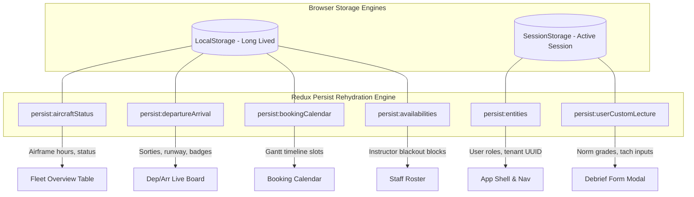

# FlightLogger REA Technical Audit: ActionCable Real-Time WebSockets & Redux Persistence

**Target System:** FlightLogger Real-Time Event Pipeline & State Persistence Tier  
**Real-Time Gateway:** ActionCable WebSockets (`/a/:tenant/cable`)  
**State Persistence Engine:** Redux Toolkit + `redux-persist` (LocalStorage & SessionStorage)  
**Investigation Framework:** REA Passive CDP Telemetry, WebSocket Frame Sniffing & Storage Decompilation  

---

## 1. Real-Time WebSocket Infrastructure

FlightLogger coordinates multi-user dispatchers, instructors, and student pilots using a centralized WebSocket pipeline. When an aircraft departs, touches down, or an instructor signs off a debrief form, connected screens update automatically without requiring manual page refreshes.

```
       Airfield Dispatch Terminal                Cockpit iPad / Tablet
       ┌────────────────────────┐               ┌────────────────────────┐
       │   Departure/Arrival    │               │   Flight Debriefing    │
       │   Wallboard Screen     │               │   Modal & Grade Sheet  │
       └───────────▲────────────┘               └───────────▲────────────┘
                   │                                        │
                   │ WebSocket Frames (/a/:tenant/cable)    │
                   │                                        │
       ┌───────────▼────────────────────────────────────────▼────────────┐
       │               ActionCable / Realtime Gateway Bus               │
       ├─────────────────────────────────────────────────────────────────┤
       │  Channels:                                                      │
       │  1. DepartureArrivalChannel  ── Airfield status & flight states  │
       │  2. BookingChannel           ── Timeline slots & reservations   │
       │  3. NotificationChannel      ── Pilot warnings & solo endorsements│
       │  4. AdminAuditChannel        ── Fleet maintenance & safety logs │
       └───────────────────────────┬─────────────────────────────────────┘
                                   │
                   ┌───────────────▼───────────────┐
                   │    PostgreSQL Database &      │
                   │    Redis Pub/Sub Layer        │
                   └───────────────────────────────┘
```

### 1.1 Connection Handshake & Channel Subscription Protocol

1. **Connection URL:** `wss://app.flightlogger.net/a/:tenant_slug/cable`
2. **Session Authentication:** Authenticates using Rails encrypted session cookie or Bearer token passed in the initial upgrade request.
3. **Channel Subscription Payload:**
   ```json
   {
     "command": "subscribe",
     "identifier": "{\"channel\":\"DepartureArrivalChannel\",\"tenant_slug\":\"trial-sa\"}"
   }
   ```
4. **Subscription Acknowledgment Frame:**
   ```json
   {
     "type": "confirm_subscription",
     "identifier": "{\"channel\":\"DepartureArrivalChannel\",\"tenant_slug\":\"trial-sa\"}"
   }
   ```
5. **Heartbeat Protocol:** The server transmits ping frames every 3 seconds: `{"type":"ping","message":1761912400}`. If 3 consecutive pings fail, the client triggers an exponential backoff reconnection loop.

---

## 2. Channel Specifications & Event Payloads

REA identified four discrete WebSocket channels operating within FlightLogger:

### 2.1 Channel 1: `DepartureArrivalChannel`
Powers the live airfield flight board (`/a/:tenant/activities/dep-arr`).

#### Event: `SORTIE_STATUS_UPDATED`
Broadcast whenever an aircraft transitions states (e.g., from `briefing` to `flight` upon takeoff).
```json
{
  "message": {
    "event": "SORTIE_STATUS_UPDATED",
    "timestamp": "2026-10-16T14:22:10Z",
    "payload": {
      "bookingId": "9b1deb4d-3b7d-4bad-9bdd-2b0d7b3dcb6d",
      "aircraftId": "8f2a1b9c-4c8d-4e0a-9e1b-2c3d4e5f6a7b",
      "callSign": "OY-AAA",
      "previousStatus": "briefing",
      "currentStatus": "flight",
      "offBlockTime": "2026-10-16T14:15:00Z",
      "airborneTime": "2026-10-16T14:22:00Z",
      "crew": {
        "instructorName": "Sakshi Gaur",
        "studentName": "Ananya Sharma"
      },
      "flightType": "dual_flight",
      "route": "EKAH - EKAH",
      "fuelRemainingLiters": 120.0
    }
  }
}
```

#### Event: `RUNWAY_CHANGED`
Broadcast when the control tower or chief flight instructor changes active runway direction.
```json
{
  "message": {
    "event": "RUNWAY_CHANGED",
    "timestamp": "2026-10-16T14:30:00Z",
    "payload": {
      "airfieldIcao": "EKAH",
      "activeRunway": "28L",
      "surfaceCondition": "DRY",
      "circuitDirection": "LEFT",
      "qnh": 1013,
      "windHeading": 270,
      "windSpeedKnots": 12
    }
  }
}
```

---

### 2.2 Channel 2: `BookingChannel`
Synchronizes the visual Gantt timeline calendar across all dispatchers and student terminals.

#### Event: `BOOKING_PUBLISHED`
Emitted when a reservation is confirmed and locked in the schedule.
```json
{
  "message": {
    "event": "BOOKING_PUBLISHED",
    "timestamp": "2026-10-16T14:35:12Z",
    "payload": {
      "bookingId": "c4b8e21a-7f3e-4d8b-9a1c-3e5f7a9b1c2d",
      "aircraftId": "8f2a1b9c-4c8d-4e0a-9e1b-2c3d4e5f6a7b",
      "instructorId": "1a2b3c4d-5e6f-7a8b-9c0d-1e2f3a4b5c6d",
      "studentId": "2b3c4d5e-6f7a-8b9c-0d1e-2f3a4b5c6d7e",
      "startTime": "2026-10-17T09:00:00Z",
      "endTime": "2026-10-17T11:00:00Z",
      "lessonCode": "Ex 4.1",
      "isLocked": true
    }
  }
}
```

#### Event: `BOOKING_CANCELLED`
Releases the visual reservation block on all connected clients.
```json
{
  "message": {
    "event": "BOOKING_CANCELLED",
    "timestamp": "2026-10-16T14:40:00Z",
    "payload": {
      "bookingId": "c4b8e21a-7f3e-4d8b-9a1c-3e5f7a9b1c2d",
      "aircraftId": "8f2a1b9c-4c8d-4e0a-9e1b-2c3d4e5f6a7b",
      "reason": "Adverse weather: Crosswind exceeding student solo limits"
    }
  }
}
```

---

### 2.3 Channel 3: `NotificationChannel`
Personalized user channel delivering regulatory warnings and approvals directly to pilots.

#### Event: `CERTIFICATE_EXPIRING_WARNING`
Alerts pilot and CFI that a critical aviation document requires urgent renewal.
```json
{
  "message": {
    "event": "CERTIFICATE_EXPIRING_WARNING",
    "timestamp": "2026-10-16T14:45:00Z",
    "payload": {
      "userId": "2b3c4d5e-6f7a-8b9c-0d1e-2f3a4b5c6d7e",
      "certificateType": "Medical Class 1",
      "expiresAt": "2026-10-31",
      "daysRemaining": 15,
      "severity": "warning",
      "blockingAction": "Will block solo flight dispatch after expiry"
    }
  }
}
```

#### Event: `SOLO_FLIGHT_ENDORSED`
Notifies student that their instructor has digitally signed off their solo flight clearance.
```json
{
  "message": {
    "event": "SOLO_FLIGHT_ENDORSED",
    "timestamp": "2026-10-16T14:50:00Z",
    "payload": {
      "studentId": "2b3c4d5e-6f7a-8b9c-0d1e-2f3a4b5c6d7e",
      "instructorName": "Sakshi Gaur",
      "lesson": "Solo Circuit Practice (3 Landings)",
      "maxWindKnots": 15,
      "validUntil": "2026-10-16T18:00:00Z"
    }
  }
}
```

---

### 2.4 Channel 4: `AdminAuditChannel`
Administrative stream broadcasting fleet maintenance events and billing transactions.
- **`MAINTENANCE_WARNING_SPAWNED`:** Emitted when an airframe's 50h/100h countdown drops to $\le 0$ flight hours.
- **`DEFECT_SQUAWK_REPORTED`:** Alerts maintenance coordinator to newly entered pilot snag remarks.
- **`ACI_INVOICE_BATCH_READY`:** Informs finance staff that unbilled completed sorties are ready for PDF generation.

---

## 3. Client State Persistence Architecture (Redux Persist)

FlightLogger preserves critical operational state across browser reloads, tablet lock-screens, and intermittent hangar Wi-Fi disconnects using **Redux Persist**.



### 3.1 LocalStorage Persistence Slices

| Persist Key | Serialization Format | Cache Strategy & Rehydration Lifecycle |
| :--- | :--- | :--- |
| `persist:aircraftStatus` | JSON dictionary keyed by `aircraftId` | Rehydrated immediately on page load. Provides instantaneous fleet availability badges prior to the initial GraphQL query response. Invalidated on `AIRCRAFT_STATUS_UPDATED` WebSocket frames. |
| `persist:departureArrival` | Normalized JSON object of active sorties | Ensures the airfield wallboard never renders a blank screen during intermittent connectivity drops. Retains last known airframe positions and active flight timers. |
| `persist:bookingCalendar` | Serialized calendar view parameters | Persists the dispatcher's active view mode (`day`, `week`, `month`), zoom level, scroll offset, and selected resource filters across page navigations. |
| `persist:availabilities` | Matrix of recurring weekly availability blocks | Caches instructor working hours and student availability grids to prevent redundant fetches when navigating between calendar weeks. |

### 3.2 SessionStorage Persistence Slices

| Persist Key | Serialization Format | Cache Strategy & Rehydration Lifecycle |
| :--- | :--- | :--- |
| `persist:entities` | Normalized entity repository | Stores current session metadata: active `tenant_id`, user profile, assigned RBAC permissions, and active curriculum IDs. Automatically erased upon browser tab close or logout. |
| `persist:userCustomLecture` | Uncommitted debrief form buffer | **Crash-Proof Debriefing:** Stores in-progress student norm scores (1–5), debrief notes, and tachometer readings. If an instructor accidentally closes the browser tab or loses power mid-debrief, reopening the flight registration form restores all unsaved ratings. |

---

## 4. Modern Implementation Blueprint for FlySilverArrows

To eliminate the operational complexity of Rails ActionCable, Redis adapter maintenance, and Redux Persist serialization boilerplate, FlySilverArrows implements an ultra-modern, zero-overhead architecture:

1. **Supabase Realtime (`realtime.send` & `postgres_changes`):**
   - Directly listens to PostgreSQL table modifications with zero backend worker code.
   - Subscribes to `INSERT`/`UPDATE` events on `bookings`, `aircraft`, and `flights`.
2. **TanStack React Query v5 + Web Storage Persistence:**
   - Automatic background refetching on window focus.
   - Built-in garbage collection and optimistic UI updates for instant drag-and-drop calendar operations.
   - Persistent offline caching via TanStack Query Sync Storage Persister.
3. **End-to-End Type Safety:**
   - Strict TypeScript interfaces for all WebSocket payloads eliminate runtime payload parsing bugs.
