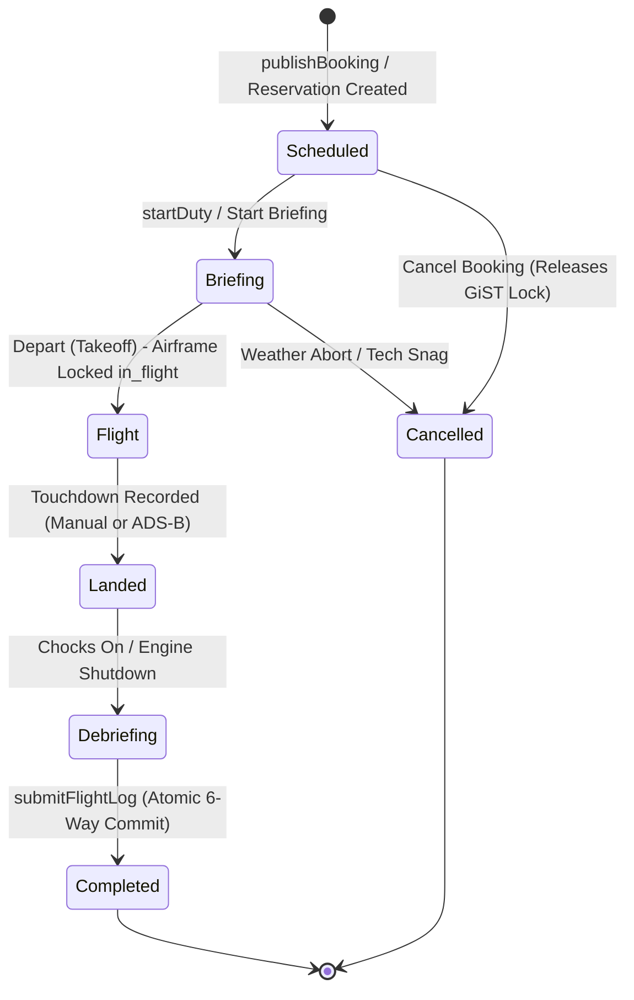

# FlySilverArrows Operational Flight Finite State Machine (FSM)

## 1. State Machine Topology & Lifecycle

FlightLogger enforces a strict finite state machine (FSM) controlling every aircraft sortie. States represent physical, operational phases of flight and airfield presence:



---

## 2. Formal Transition Matrix & Guard Conditions

| Current State | Target State | Triggering RPC / Action | Mandatory Pre-Conditions & Guards | Side Effects Executed |
| :--- | :--- | :--- | :--- | :--- |
| `draft` | `scheduled` | `fn_publish_booking()` | Passes 7-point pre-flight gating; no GiST exclusion conflict. | Injects reservation into active timeline; notifies crew. |
| `scheduled` | `briefing` | `fn_start_briefing()` / `startDuty` | Current time within 2 hours of `start_time`; instructor present. | Clocks in active duty in `duty_records`; updates board badge to Amber. |
| `scheduled` | `cancelled` | `fn_cancel_booking()` | Allowed by student, instructor, or admin prior to engine start. | Releases GiST range locks; records cancellation reason. |
| `briefing` | `flight` | `fn_record_takeoff()` | Aircraft airworthiness verified; no open grounding snags. | Sets `off_block_time = NOW()`; locks aircraft status to `in_flight`. |
| `briefing` | `cancelled` | `fn_cancel_booking()` | Pre-flight weather or tech abort prior to departure. | Reverts aircraft to airworthy; clocks out duty as ground briefing. |
| `flight` | `landed` | `fn_record_touchdown()` | Touchdown time recorded (manual dispatcher click or ADS-B $< 30$ kts). | Sets `landing_time = NOW()`; updates board badge to Landed. |
| `landed` | `debriefing` | `fn_record_on_block()` | Aircraft chocks on at apron; engine shut down. | Sets `on_block_time = NOW()`; opens flight registration modal. |
| `debriefing` | `completed` | `fn_register_flight()` | Instructor digital signature valid; norm grades $\ge 1$; tach $\Delta > 0$. | **Executes 6-Way Atomic Post-Flight Commit Pipeline**. |

---

## 3. Forbidden Transitions & Error Handling

Any attempt to execute an invalid state jump raises an explicit exception:

1. **Direct Completion Blocked:**
   - Attempting `scheduled` $\to$ `completed` raises `INVALID_TRANSITION: Cannot complete a flight without physical takeoff and landing`.
2. **Airborne Direct Completion Blocked:**
   - Attempting `flight` $\to$ `completed` raises `INVALID_TRANSITION: Aircraft is currently airborne; touchdown must be recorded before debriefing`.
3. **Airborne Cancellation Blocked:**
   - Attempting `flight` $\to$ `cancelled` raises `ILLEGAL_CANCELLATION: Cannot cancel a sortie while aircraft is airborne`.

---

## 4. PostgreSQL PL/pgSQL Stored Procedure Implementation

```sql
CREATE OR REPLACE FUNCTION fn_transition_booking(
  p_booking_id UUID,
  p_target_status booking_status_enum,
  p_actor_id UUID,
  p_metadata JSONB DEFAULT '{}'::jsonb
)
RETURNS JSONB
LANGUAGE plpgsql
SECURITY DEFINER
AS $$
DECLARE
  v_booking RECORD;
  v_allowed BOOLEAN := FALSE;
  v_old_status booking_status_enum;
BEGIN
  -- 1. Fetch current booking under row-level lock
  SELECT * INTO v_booking FROM bookings WHERE id = p_booking_id FOR UPDATE;
  
  IF NOT FOUND THEN
    RAISE EXCEPTION 'Booking % not found', p_booking_id;
  END IF;

  v_old_status := v_booking.status;

  -- 2. Validate Transition Legal Paths
  IF v_old_status = 'scheduled' AND p_target_status IN ('briefing', 'cancelled') THEN
    v_allowed := TRUE;
  ELSIF v_old_status = 'briefing' AND p_target_status IN ('flight', 'cancelled') THEN
    v_allowed := TRUE;
  ELSIF v_old_status = 'flight' AND p_target_status = 'landed' THEN
    v_allowed := TRUE;
  ELSIF v_old_status = 'landed' AND p_target_status = 'debriefing' THEN
    v_allowed := TRUE;
  ELSIF v_old_status = 'debriefing' AND p_target_status = 'completed' THEN
    v_allowed := TRUE;
  END IF;

  IF NOT v_allowed THEN
    RAISE EXCEPTION 'Illegal state transition from % to % for booking %', 
      v_old_status, p_target_status, p_booking_id;
  END IF;

  -- 3. Execute Transition Specific Side-Effects
  IF p_target_status = 'briefing' THEN
    -- Clock in instructor duty if not already active
    INSERT INTO duty_records (tenant_id, user_id, duty_start_time, is_active)
    VALUES (v_booking.tenant_id, v_booking.instructor_id, NOW(), TRUE)
    ON CONFLICT DO NOTHING;

  ELSIF p_target_status = 'flight' THEN
    -- Lock aircraft to in_flight
    UPDATE aircraft SET status = 'maintenance_due' 
    WHERE id = v_booking.aircraft_id AND status = 'airworthy';

  ELSIF p_target_status = 'completed' THEN
    -- Verify flight log is committed
    IF NOT EXISTS (SELECT 1 FROM flights WHERE booking_id = p_booking_id) THEN
      RAISE EXCEPTION 'Cannot mark completed without committed flight log';
    END IF;
  END IF;

  -- 4. Update Booking Status
  UPDATE bookings 
  SET status = p_target_status, updated_at = NOW() 
  WHERE id = p_booking_id;

  -- 5. Record Audit History
  INSERT INTO booking_conflicts (booking_id, conflict_type, details, overridden_by_user_id)
  VALUES (p_booking_id, 'STATUS_TRANSITION', 
          format('Status changed from %s to %s', v_old_status, p_target_status), 
          p_actor_id);

  RETURN jsonb_build_object(
    'success', true,
    'bookingId', p_booking_id,
    'previousStatus', v_old_status,
    'currentStatus', p_target_status
  );
END;
$$;
```

---

## 5. Real-Time Broadcast Integration
Upon successful execution of `fn_transition_booking`, the backend emits a real-time WebSocket frame across `DepartureArrivalChannel`:
```json
{
  "event": "SORTIE_STATUS_UPDATED",
  "bookingId": "c4b8e21a-7f3e-4d8b-9a1c-3e5f7a9b1c2d",
  "previousStatus": "briefing",
  "currentStatus": "flight",
  "timestamp": "2026-10-31T01:20:00Z"
}
```
